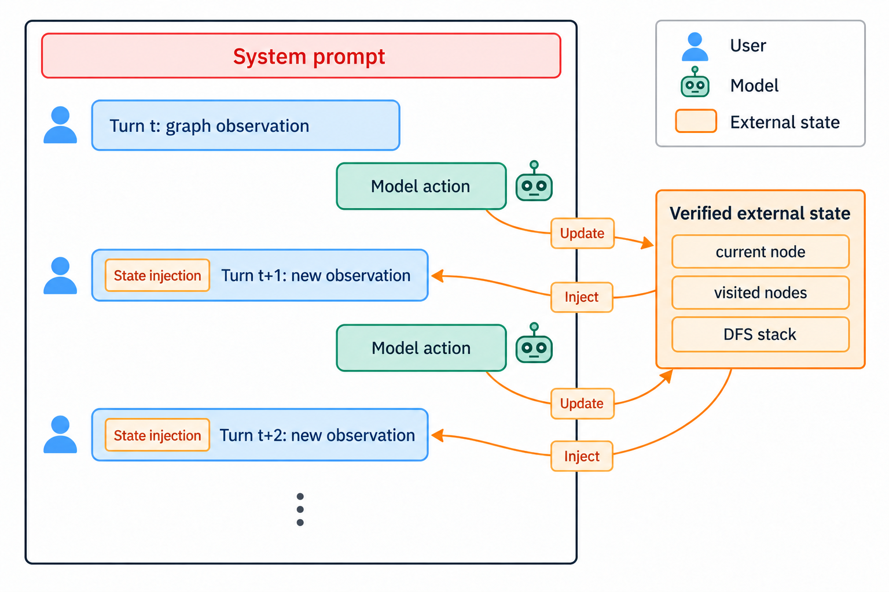
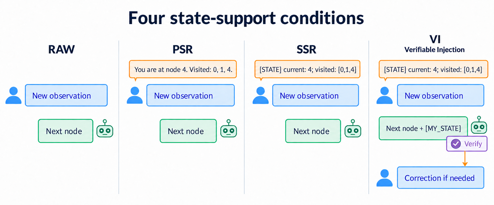
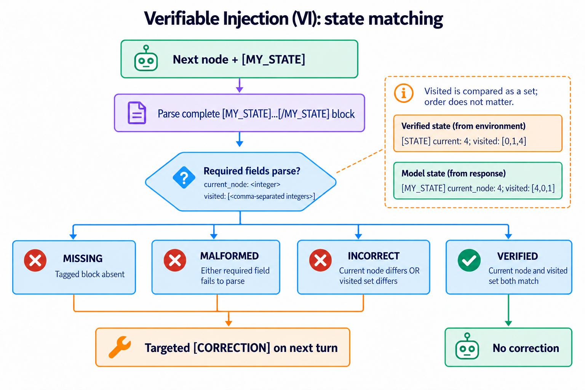
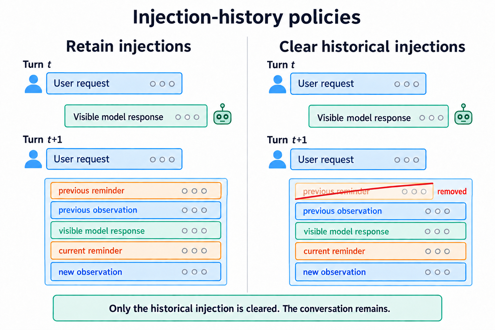
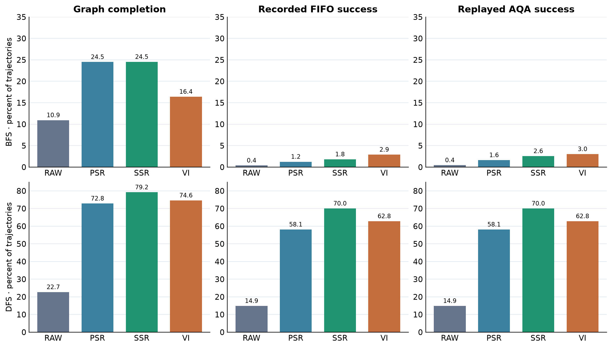
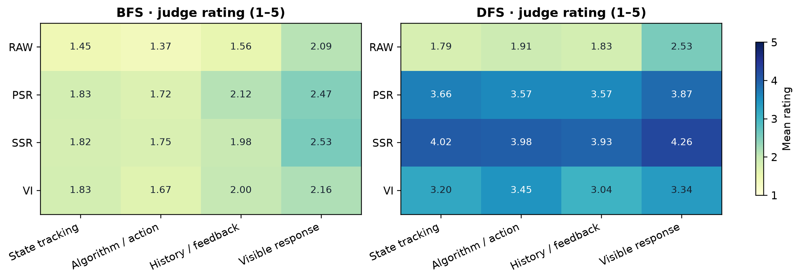
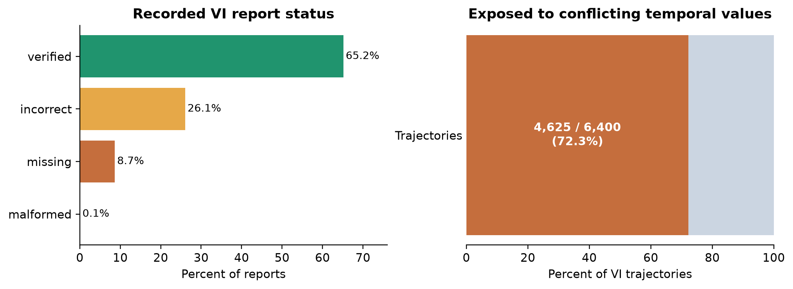

# From Conversation History to Task State: Diagnosing Small Language Models under Incremental Observations

Apurbo Banik Turjo

**Collaborators:** Sushmita Paul, Dr. Ch. Md. Rakin Haider

Research progress updated 15 October 2026. Paper in preparation.

This repository presents the study's design and current results. The aggregate
analysis is public here; raw trajectories, full prompts, and run manifests are
not included.

## Research question

An agent acting over many turns must use each new observation without losing
the task state built so far. We ask whether externally maintained state,
conversation history, and state-report verification help small language models
complete interactive tasks while following the required algorithm.

We study breadth-first search (BFS) and depth-first search (DFS) on partially
observed trees. Each turn reveals only the neighbors of the node reached.
These tasks let us separate visiting all nodes from following the correct
traversal order. They are controlled diagnostics, not the full range of agents
we hope to study.

## Experimental setup

The completed inference campaign contains **25,600 trajectories**: four model
checkpoints, two tasks, two difficulty levels, four state-support conditions,
two history policies, and 200 matched graphs per exact cell. The models are
Qwen3-1.7B, Qwen3.5-2B, Qwen3.5-4B, and Gemma-4-E4B-IT. Inference used one
H100 NVL with a vLLM server, up to 16 concurrent episodes, greedy decoding
(temperature 0), a 4,096-token output cap, a 2,048-token thinking budget,
and a 32,768-token context limit.

| Condition | State support |
| --- | --- |
| **RAW** | Current observation, with no injected state reminder. |
| **PSR: Prose State Reminder** | Verified state restated in ordinary language. |
| **SSR: Structured State Reminder** | The same task-specific facts in a tagged state block. |
| **VI: Verifiable Injection** | SSR plus a required state report, checked against the environment, with feedback after a missing, malformed, or incorrect report. |

Both PSR and SSR supply the current node and visited set. In the completed
campaign, DFS also receives its root-to-current stack, while BFS does not
receive an ordered queue. This matters when interpreting differences between
the tasks.

We also vary what remains in the conversation. Under **retain**, earlier
injected reminders remain. Under **clear injection**, only the older reminder
text is removed; previous observations and visible model replies remain.
The current reminder is always present.

## Research progress

This is a changing checklist. Completed items preserve what was tested at that
stage; open items record the next analysis or experiment rather than presenting
preliminary observations as final claims.

- [x] ~~Run the original state-support study.~~ **25,600 trajectories** across
  four models, BFS and DFS, two difficulties, RAW/PSR/SSR/VI, and two history
  policies.
- [x] ~~Audit the behavioral metrics and complete the primary LLM-judge pass.~~
  The objective analysis covers all trajectories; the primary judge pass covers
  2,560 paired trajectories.
- [x] ~~Run a matched control-state follow-up.~~ The H100 follow-up reran all
  **25,600 state-support trajectories** while supplying the BFS queue and
  withholding the DFS stack. This removes the original queue/stack asymmetry
  without changing the four models, selected graphs, or 200-problem cell size.
- [x] ~~Pilot model-owned memory.~~ A further **6,400 trajectories** compare
  model-written memory carried with full history against memory as the model's
  only cross-turn state. The model could choose and replace any inner JSON
  schema; only the outer action-and-memory response envelope was fixed.
- [ ] Complete the matched comparison between the original and symmetric
  state-support campaigns, including per-model and per-difficulty uncertainty.
- [ ] Rerun the model-owned-memory pilot with schema-constrained outer JSON.
  In the current autonomous-memory lane, 14,660 of 57,820 calls were rejected;
  90.6% of those rejections began with non-JSON output, primarily Markdown
  fences. The rerun should preserve unrestricted model-designed memory while
  separating memory quality from response-envelope compliance.
- [ ] Complete judge repeatability and independent human calibration.
- [ ] Evaluate a time-aligned VI protocol and extend the study beyond graph
  traversal.

The latest H100 campaign contains **32,000 trajectories** in total. The
following results are preliminary and use the current non-teacher-forced
traversal scorer. Each state-support row pools 3,200 trajectories and reports
completion, correct traversal prefix, and algorithm-correct completion.

| Task | Condition | Graph completion | Correct traversal prefix | Algorithm-correct completion |
| --- | --- | ---: | ---: | ---: |
| BFS with queue | RAW | 10.00% | 12.08% | 0.28% |
| BFS with queue | PSR | 82.09% | 47.15% | 33.19% |
| BFS with queue | SSR | 87.75% | 57.21% | 45.91% |
| BFS with queue | VI | 80.25% | 47.68% | 35.31% |
| DFS without supplied stack | RAW | 25.41% | 51.40% | 16.38% |
| DFS without supplied stack | PSR | 51.16% | 79.42% | 40.53% |
| DFS without supplied stack | SSR | 46.88% | 80.32% | 38.38% |
| DFS without supplied stack | VI | 41.75% | 74.22% | 32.72% |

The memory pilot has 3,200 trajectories per design:

| Memory design | Graph completion | Correct traversal prefix | Algorithm-correct completion |
| --- | ---: | ---: | ---: |
| Model-written memory with full history | 12.03% | 17.32% | 6.41% |
| Model-written memory as the only cross-turn state | 2.97% | 11.70% | 0.59% |

The autonomous-memory result currently measures both memory management and
strict JSON-envelope compliance. It should therefore be treated as a diagnosed
pilot outcome, not evidence that model-designed memory itself is ineffective.

## What the metrics mean

Let `V` be all graph nodes, `U_K` the nodes visited after `K` accepted
moves, `L` the recorded node-history length, and `ell` the uninterrupted
initial sequence of algorithm-correct accepted moves.

| Measure | Definition | Why it matters |
| --- | --- | --- |
| **Graph completion** | `C = 1[U_K = V]` | Did the model visit every node, regardless of order? |
| **Correct traversal prefix** | `P = ell / L` | How long did it follow BFS or DFS before the first deviation? Later recovery does not restore the prefix. |
| **Algorithm-correct completion** | `S = 1[C = 1 and P = 1]` | Did it both finish and preserve the required traversal order? |
| **Zero-error FIFO success** | `S_0 = 1[S_FIFO = 1 and invalid attempts = 0 and format failures = 0]` | How often was strict traversal success achieved without recorded interface errors? |
| **Valid-move rate** | admissible attempts / all recorded attempts | Separates legal moves from algorithmically correct moves. |
| **Final decoverage** | `1 - |U_K| / |V|` | Fraction of nodes left undiscovered. |

AQA-Bench also records accumulated decoverage, the sum of uncovered fractions
after accepted moves. It is useful for following progress, but a short failed
episode can have a deceptively small sum. We read it alongside completion and
episode length.

The BFS campaign was originally scored with a strict FIFO-head checker.
We also replayed its recorded actions under the historical AQA-Bench BFS
frontier checker. The main **AQA success** values below use that replayed
checker; FIFO success answers the stricter prompt-specific question. DFS
scores coincide under the two rules. A valid move can still break either
traversal order.

## Behavioral results

Every task-condition row below pools 3,200 trajectories across models,
difficulties, and history policies.

| Task | Condition | Graph completion | AQA algorithm-correct completion |
| --- | --- | ---: | ---: |
| BFS | RAW | 10.94% | 0.44% |
| BFS | PSR | 24.50% | 1.63% |
| BFS | SSR | 24.53% | 2.56% |
| BFS | VI | 16.41% | 3.03% |
| DFS | RAW | 22.69% | 14.88% |
| DFS | PSR | 72.84% | 58.13% |
| DFS | SSR | 79.19% | 70.00% |
| DFS | VI | 74.59% | 62.81% |

State support improves completion in both tasks, but much more in DFS.
Relative to RAW, SSR raises completion by **13.59 percentage points in BFS**
and **56.50 points in DFS**. BFS illustrates why completion and algorithm
adherence must be reported separately: under SSR, 24.53% visit every node,
but only 2.56% finish with an uninterrupted AQA-correct prefix.

The format contrast is also task-dependent. SSR minus PSR completion is
**+0.03 points in BFS** and **+6.34 points in DFS**; the corresponding AQA
success differences are **+0.94** and **+11.88 points**. These are matched
within-task comparisons, not evidence that structure has one uniform effect.

Keeping older reminders raises completion by **15.97 points for PSR** and
**19.03 points for SSR** relative to clearing them. RAW has no reminder to
retain; its 0.88-point difference is a repeated-control comparison. The
contrasts are descriptive for these models, graphs, prompts, and run limits.

## LLM judge and reasoning traces

A separate primary pass used **claude-opus-4-6-thinking** to judge **2,560**
paired trajectories, including 20 shared graph IDs per task-difficulty
stratum across all models, conditions, and histories. The judge received a
fixed rubric, visible responses and captured reasoning, actions, and
authoritative graph facts. Model, condition, history-policy labels, and
aggregate outcome scores were withheld. Prompt content still revealed some
state-support cues.

It scored four 1–5 criteria:

1. State tracking.
2. Algorithmic reasoning and action coherence.
3. History and feedback use.
4. Visible response quality.

The equal-weight mean of these four ordinal ratings is **1.82 for RAW**,
**2.85 for PSR**, **3.03 for SSR**, and **2.59 for VI**. These are
descriptive process ratings, not independently validated measurements of
hidden reasoning. The judge also recorded a dominant-failure label and
turn-cited rationale. Inspected traces show concrete state and action errors,
but selected examples do not establish how often a mechanism occurs.

All 2,560 primary judgments were extracted with no schema validation errors.
Seven semantic warning flags were inspected. The selected **246 repeat
judgments remain unrun**, and an independent blinded human-calibration study
is not complete.

## Limits and next steps

The study uses four checkpoints, one prompt family, selected trees, finite
token limits, and one execution per cell. DFS received a stack while BFS did
not receive its queue, so their different gains do not isolate task difficulty
or an equal amount of algorithmic support.

VI combines a state report, delayed feedback, and a prompt-format tension.
In **4,625 of 6,400 VI trajectories**, at least one correction about a
previous turn appears alongside different current-state values. Those
observations describe the implemented VI protocol; they do not identify the
causal effect of verification alone.

The live checklist above tracks the follow-up analyses and experiments. The
paper will keep behavioral outcomes primary and judge analysis exploratory
until the repeatability and human-calibration checks are complete.

---

**Apurbo Banik Turjo** · Dhaka, Bangladesh  
[GitHub](https://github.com/excellencior) · [Portfolio](https://abturjo.onrender.com/) · [LinkedIn](https://www.linkedin.com/in/apurbo-banik-turjo-86b5b3328/) · [Email](mailto:turjob44@gmail.com)
